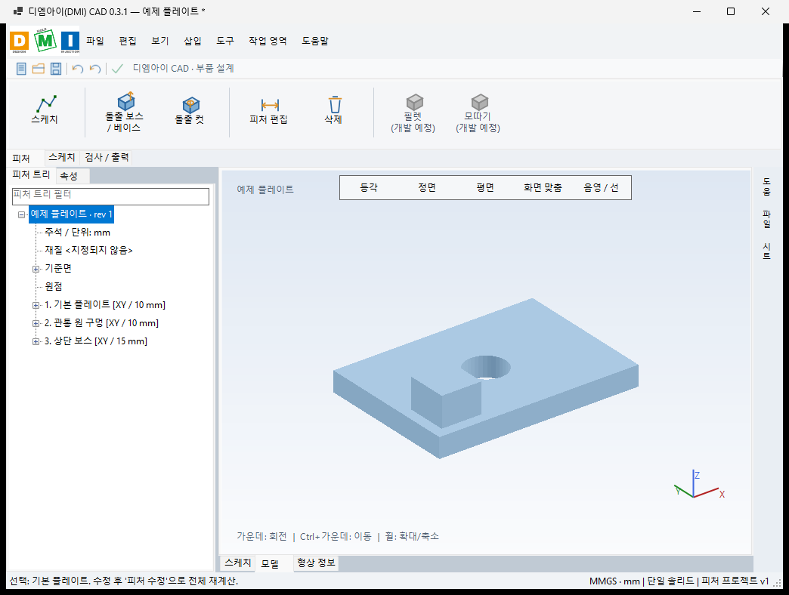
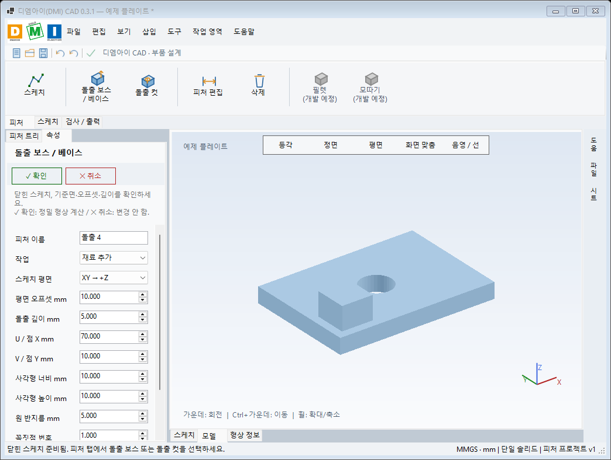

# 0.3.1 인터페이스 검증 기록

검증일: 2026-10-25  
[Windows 검사 실행](https://github.com/dmi20190118-tech/dmi-cad/actions/runs/40161109021)

## 기준
SOLIDWORKS 2020 공식 도움말에 문서화된 기본 배치를 참고했다. 원본 아이콘·로고를 복제하지 않고 디엠아이 브랜드와 자체 아이콘을 사용했다.
상세 출처와 사용 순서: [인터페이스 안내](INTERFACE-0.3.1.ko.md).

## 1. 모델 화면

상단 메뉴/빠른 도구/작업별 명령 탭, 왼쪽 피처 트리와 필터, 모델 위 보기 도구, 오른쪽 바로가기, 하단 보기 탭과 상태를 확인했다.
트리에는 실제 계산한 플레이트·구멍·보스 피처가 표시된다.
미지원 기능은 개발 예정·비활성 상태로 구분한다.

## 2. 속성 입력 화면

실제 Form의 속성 편집 상태를 캡처했다. 확인/취소, 평면·오프셋·깊이·좌표와 치수 입력이 표시된다.
속성 항목은 세로 스크롤을 사용한다. 화면 높이에 따라 아래 항목은 스크롤해야 한다.

## 통과한 자동 검사
- 기존 CAD 변환, 정확한 부피, 피처 재계산, 잘못된 형상 거절.
- STL/DXF, 프로젝트 구조/스냅샷, 지시서 입력, 깊이 버퍼.
- 실제 GUI에서 스케치 정의와 종료.
- 속성 활성화 및 확인으로 새 피처 생성.
- 취소가 기존 프로젝트를 변경하지 않는지 비교.
- 실행 취소/다시 실행.
- 피처 이름 필터.
- 피처에서 최상위 항목으로 이동할 때 선택 대상 해제.
- Windows 프로그램 시작 및 두 화면 캡처.
- 설치 실행파일 생성.

## 확인하지 못한 부분
SOLIDWORKS 2020 실행본과 동시 비교, 모든 마우스/키보드 작업, 접근성 적합성, 여러 Windows 배율과 모니터, 실제 사용자 작업 시험, 설치·제거 전체 수동 검증은 수행하지 않았다.
캡처 한 환경의 구조·동작 검증이며 완전한 시각적 동일성이나 기능 동등성 판정이 아니다.
